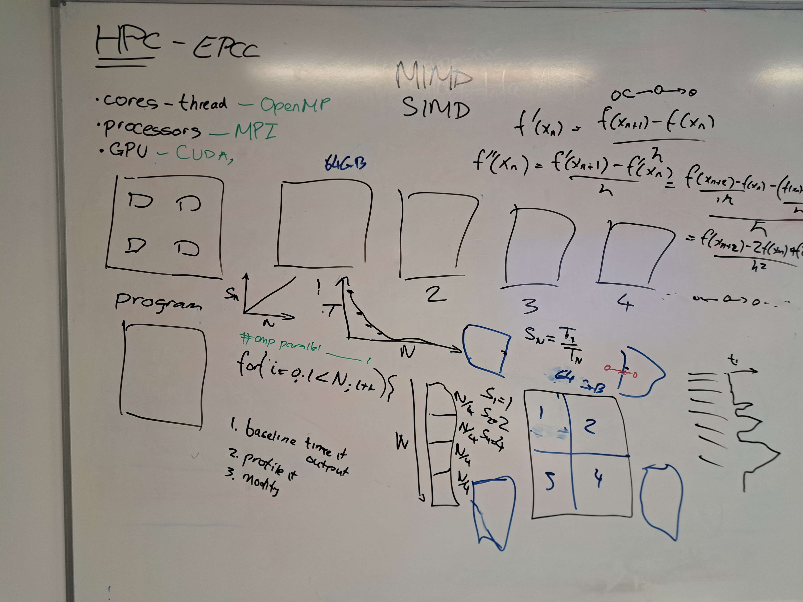

# WorkExperience26
Work experience for October 12-16th October 2026.

## Content

* [Topics](#topics)
* [Requirements](#requirements)
* [Timetable](#timetable)
* [Resources](#resources)

## Topics

Stuff you learned about:

* Using the command line:
  * `ls`, `pwd`, `cd`, `rm`, `mkdir`, `which`
  * On Windows can get `bash` using `git bash` part of the `git` install or you can install the Windows Subsytem for Linux in the Powershell:
    ```powershell
    # To see what distributions are available
    wsl.exe --list --online
    # Can install the Ubuntu distribution
    wsl.exe -- install Ubuntu
    # Will ask you to create an account - set a password you will not 
    # forget. Can launch from the command line using:
    # wsl.exe -d Ubuntu
    # or in a powershell window you can just type bash
    ```

  * Course: Software Carpentry [The Unix Shell](https://swcarpentry.github.io/shell-novice/)

* Using an editor:
  * `vi`, `nano`, [visual studio code](https://code.visualstudio.com/download)

* Markdown ([cheat sheet](https://www.markdownguide.org/cheat-sheet/))

* Git and GitHub
  * local git repo, set credentials (`git config --global user/email`), create repo in a sub directory (`git init`), status (`git status`), adding (`git add`), committing (`git commit`) 
  * remote repo, pulling (`git pull`), pushing (`git push`), hurdles, resolving conflicts
  * cloning remote repositories
  * forked repositories
    * Doing pull requests
  * creating and navigating branches
  * Course: Software Carpentry [Version Control with Git](https://swcarpentry.github.io/git-novice/)

* Python
  * Virtual environments:
    ```shell
    python -m venv .myenv
    . .myenv/bin/activate
    ```
  * Jupyter notebooks
    on gitbash needed to downgrade python to use version 3.13 otherwise jupyter would not install
    
    ```bash
     py -3.13 -m venv .jupyterenv
    ```
  * AI programming assists
  * Courses: Software Carpentry [Programming with Python](https://swcarpentry.github.io/python-novice-inflammation/) or [Plotting and Programming with Python](https://swcarpentry.github.io/python-novice-gapminder/)

* Quick run through of HPC in a whiteboard



## Requirements

In order to participate you will need to bring a Windows or Mac laptop in which you have the rights to install software. If you do not have access to such a machine please get in touch and I will try to source a laptop for the duration of the work experience.

Software that will be needed ( you do NOT have to preinstall these pieces of software - we can do that as needed):

1. [git](https://git-scm.com/install)
2. bash

## Timetable

Assume a one hour break for lunch.
Run from 9:30 to 12, a 1 hour lunch break, in the afternoon it will be mainly consolidating by following courses.
ACF tour on Tuesday.

## Induction

* Welcome to EPCC 
* Sort out:
  * Get Visitor passes for entry into the Bayes
  * Network laptops

## Resources

* BBC World Service [Inside a supercomputer: A Tech Life special](https://www.bbc.co.uk/sounds/play/w3ct8jyj) (26 mins), actually talks about the supercomputer at Edinburgh. Available on 07/10/26.
